<div align="center">

<picture>
  <source media="(prefers-color-scheme: dark)" srcset="docs/branding/logo-escuro.png">
  
</picture>

**Controle financeiro pessoal, simples e bonito: lançamentos, gastos fixos, orçamentos, metas e viagens, com chat e voz para lançar em segundos.**

### 👉 [Abrir o Nexus Financy IA](https://gabrielmacsantos.github.io/sistema_gestao/)
### 📱 [Baixar o app para Android (APK)](https://github.com/gabrielmacsantos/sistema_gestao/releases/download/app-latest/minhas-financas.apk)

Funciona no celular e no computador, sem instalar nada no site e **sem servidor**: seus dados ficam no seu aparelho e, se você entrar com o Google, numa pasta escondida do **seu** Google Drive.


-3DDC84?logo=android&logoColor=white)


<br/>

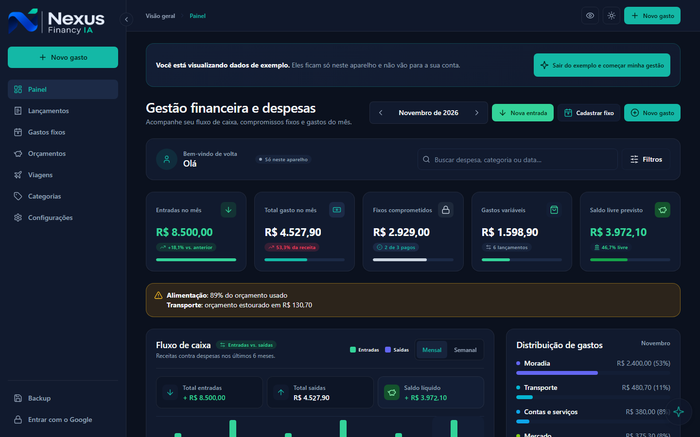

</div>

---

> ### 🧪 Versão de teste (BETA)
> O app está em fase de testes e é **gratuito** enquanto durar. A versão de teste fica disponível **até 31 de janeiro de 2027, às 23h59** (horário de Brasília): o aviso no topo mostra quantos dias faltam, e depois dessa data o link mostra uma mensagem de encerramento. Depois da publicação oficial, o download nas lojas (Google Play e App Store) será pago, com valor único e sem assinatura.
>
> **Achou um problema ou tem uma ideia?** Escreva para **[gabrielmac.dossantos@gmail.com](mailto:gabrielmac.dossantos@gmail.com)**: dúvidas, bugs e sugestões são bem-vindos.

**Sumário:** [O que dá para fazer](#-o-que-dá-para-fazer) · [Telas](#-telas) · [Como usar](#-como-usar) · [Seus dados e a privacidade](#-seus-dados-e-a-privacidade) · [Perguntas frequentes](#-perguntas-frequentes) · [Para quem mantém o projeto](#-para-quem-mantém-o-projeto)

---

## ✨ O que dá para fazer

| | |
|---|---|
| 📊 **Painel do mês** | Entradas, total gasto, fixos comprometidos, gastos variáveis e **saldo livre previsto**, com fluxo de caixa (últimos 6 meses ou semana a semana), distribuição por categoria e alertas de orçamento. |
| 🧭 **Auditoria & Ritmo Mensal** | Filtre o extrato por **Pago, Pendente ou Em análise**, veja quanto das saídas já foi pago, a **margem segura** do mês e o ritmo de cada dia da semana. Os filtros ativos aparecem como etiquetas que você remove com um toque. |
| 🧾 **Lançamentos** | Despesas e receitas com filtros por mês, tipo, situação e categoria, e busca que ignora acento e maiúscula (acha também pelo valor, como "45,90"). Um toque marca como pago. Dá para anexar a foto do comprovante. |
| 💬 **Chat de lançamentos** | Escreva ou fale *"gastei 45,90 no almoço hoje"*: o chat preenche tudo, pergunta só o que faltar e lança. Você pode editar ou excluir na hora. |
| 🎤 **Lançar falando** | No formulário de novo gasto (e de novo gasto fixo), o **Assistente de voz** preenche valor, descrição, categoria e data para você conferir e salvar. |
| 🧮 **Calculadora** | No balão de atalhos, sem internet, e com um botão para mandar o resultado direto para um lançamento. |
| 🔁 **Gastos fixos** | Aluguel, contas e assinaturas geram sozinhos um lançamento pendente por mês. Editar um fixo nunca mexe no passado. |
| 🎯 **Orçamentos e metas** | Limite mensal por categoria, com alerta a partir de 80%, e metas de economia que comemoram com confete quando você as alcança. |
| ✈️ **Viagens** | Os gastos de uma viagem ficam **separados** da gestão do mês. Você escolhe, viagem por viagem, se eles entram ou não na conta. |
| 🏷️ **Categorias** | Categorias de despesa e de receita, com cor, e um conjunto padrão já pronto. |
| 🎓 **Tutorial passo a passo** | No primeiro acesso, um tour por todas as telas explica o que cada coisa faz. Dá para refazê-lo quando quiser. |
| 🌗 **Tema escuro e claro** | Escuro por padrão, com a escolha guardada no aparelho. |
| 🙈 **Ocultar valores** | O ícone de olho no topo esconde todos os valores em lugares públicos. |
| 💾 **Backup e conta** | Backup em arquivo, restauração, sincronização entre aparelhos pela sua conta Google e exclusão da conta e dos dados em duas etapas. |

> Nesta versão de teste, a **importação de extrato, de NFC-e e de foto de cupom** e a **leitura de notificações do banco** estão desligadas (o código existe, e elas voltam numa próxima versão).

---

## 📱 Telas

### No computador

<table>
  <tr>
    <td width="50%">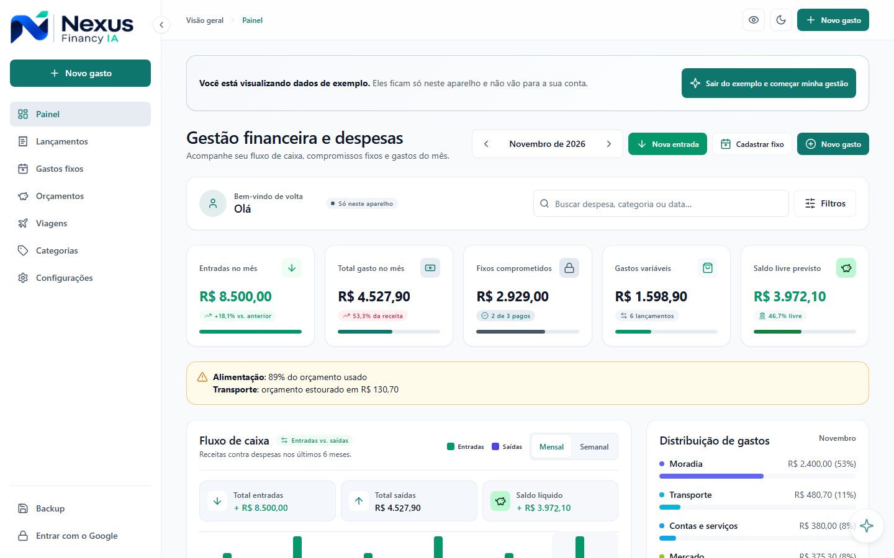</td>
    <td width="50%">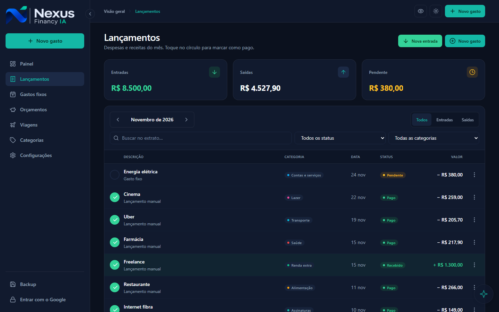</td>
  </tr>
  <tr>
    <td align="center"><sub><b>Painel</b> · tema claro</sub></td>
    <td align="center"><sub><b>Lançamentos</b> · filtros, busca e situação de cada um</sub></td>
  </tr>
  <tr>
    <td width="50%">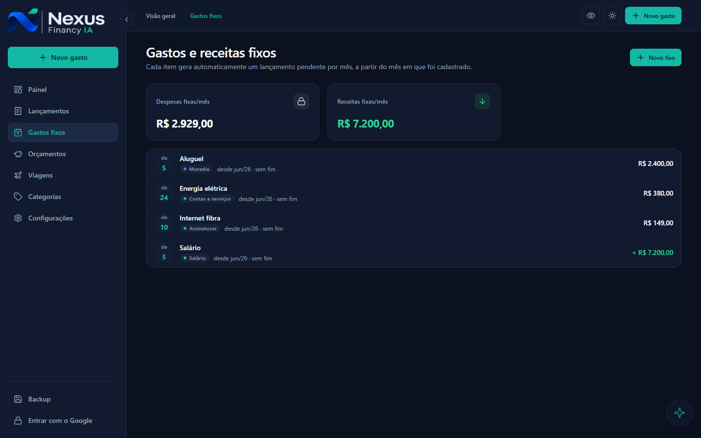</td>
    <td width="50%">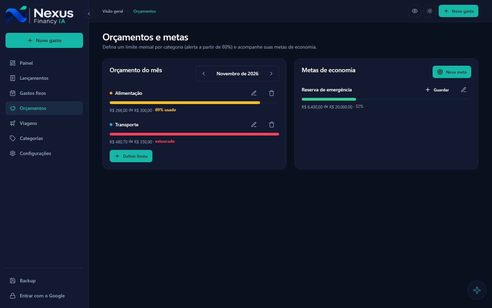</td>
  </tr>
  <tr>
    <td align="center"><sub><b>Gastos fixos</b> · um lançamento pendente por mês</sub></td>
    <td align="center"><sub><b>Orçamentos e metas</b> · alerta a partir de 80%</sub></td>
  </tr>
</table>

<p align="center">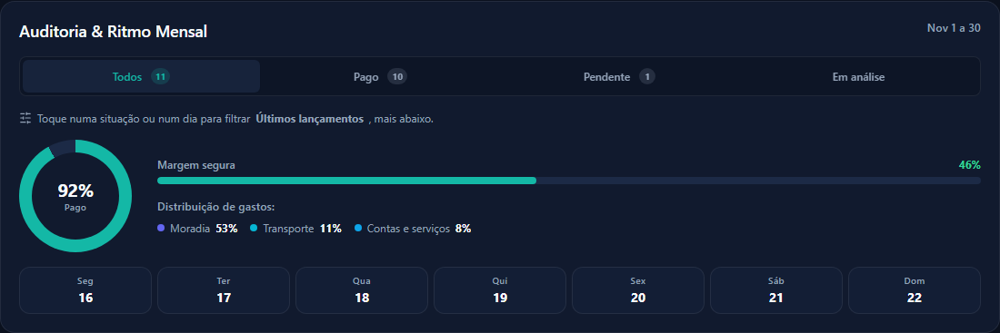<br><sub><b>Auditoria & Ritmo Mensal</b> · situação dos lançamentos, margem segura, maiores categorias e a semana</sub></p>

<p align="center">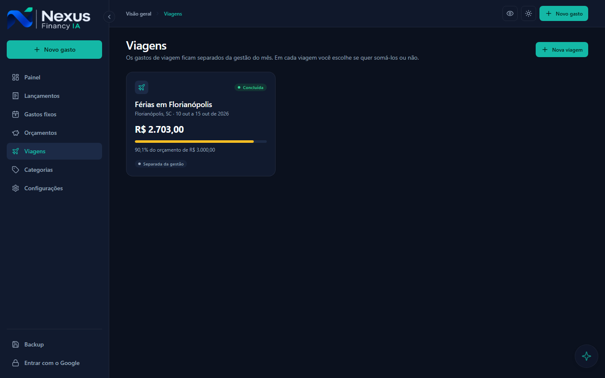<br><sub><b>Viagens</b> · gastos separados da gestão do mês</sub></p>

### No celular

<table>
  <tr>
    <td width="25%">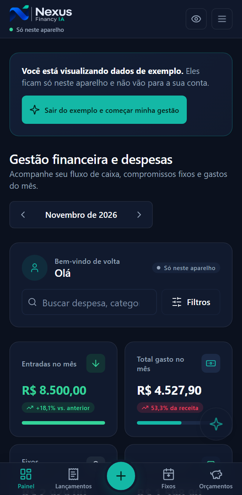</td>
    <td width="25%">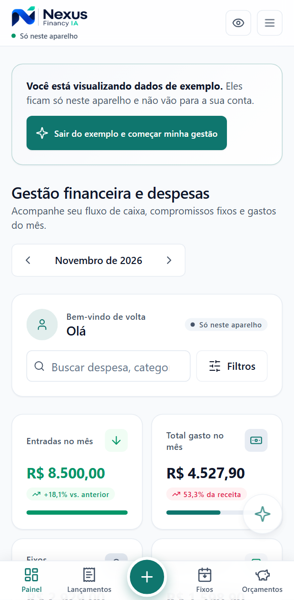</td>
    <td width="25%">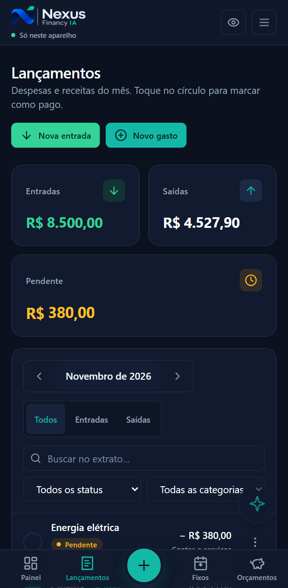</td>
    <td width="25%">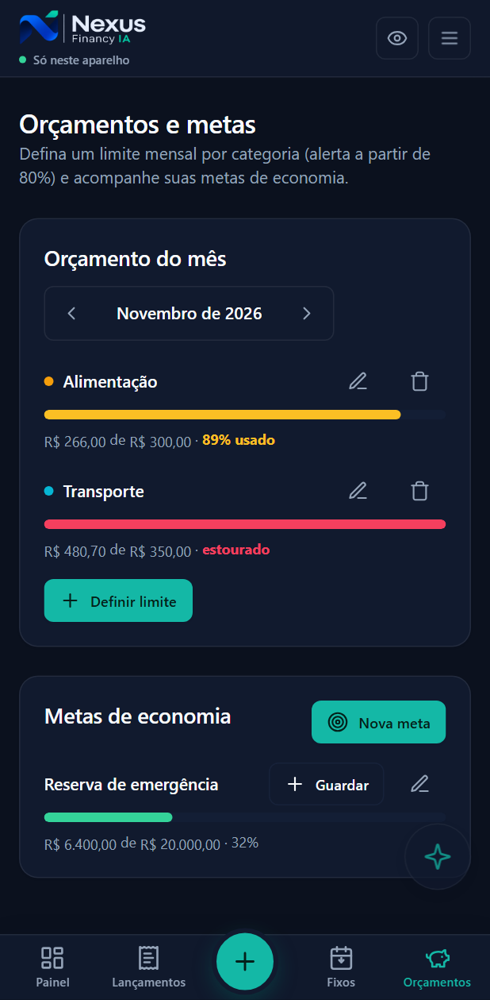</td>
  </tr>
  <tr>
    <td align="center"><sub>Painel · escuro</sub></td>
    <td align="center"><sub>Painel · claro</sub></td>
    <td align="center"><sub>Lançamentos</sub></td>
    <td align="center"><sub>Orçamentos e metas</sub></td>
  </tr>
  <tr>
    <td width="25%">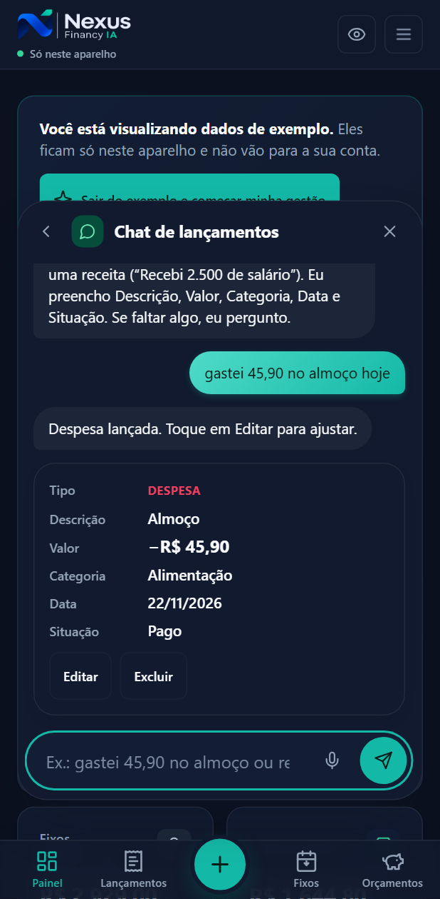</td>
    <td width="25%">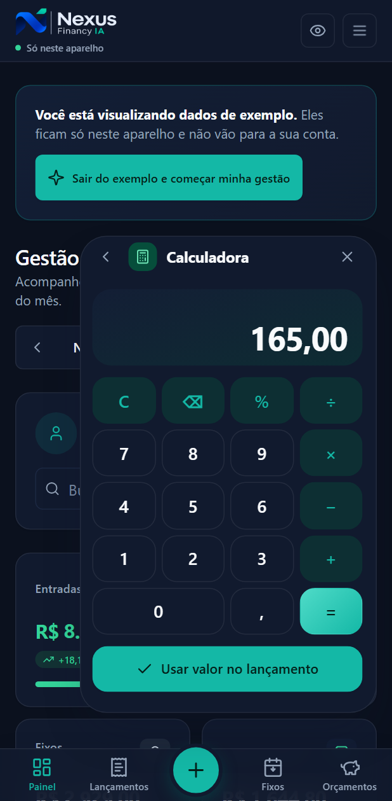</td>
    <td width="25%">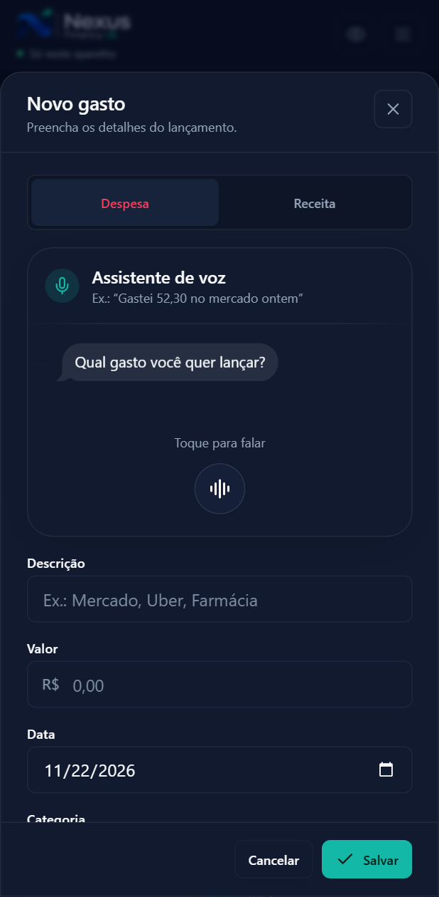</td>
    <td width="25%">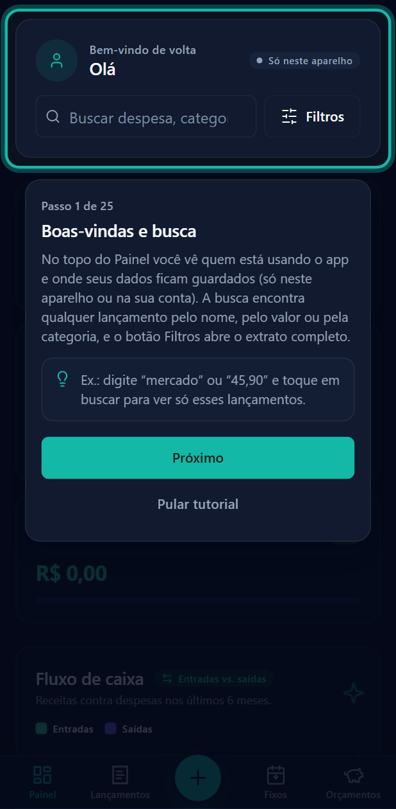</td>
  </tr>
  <tr>
    <td align="center"><sub>Chat de lançamentos</sub></td>
    <td align="center"><sub>Calculadora</sub></td>
    <td align="center"><sub>Novo gasto com voz</sub></td>
    <td align="center"><sub>Tutorial</sub></td>
  </tr>
</table>

<p align="center">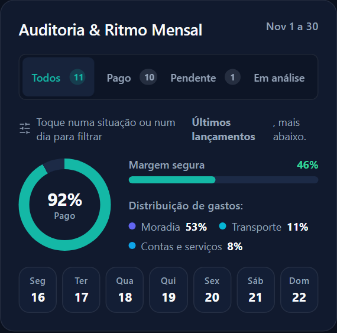&nbsp;&nbsp;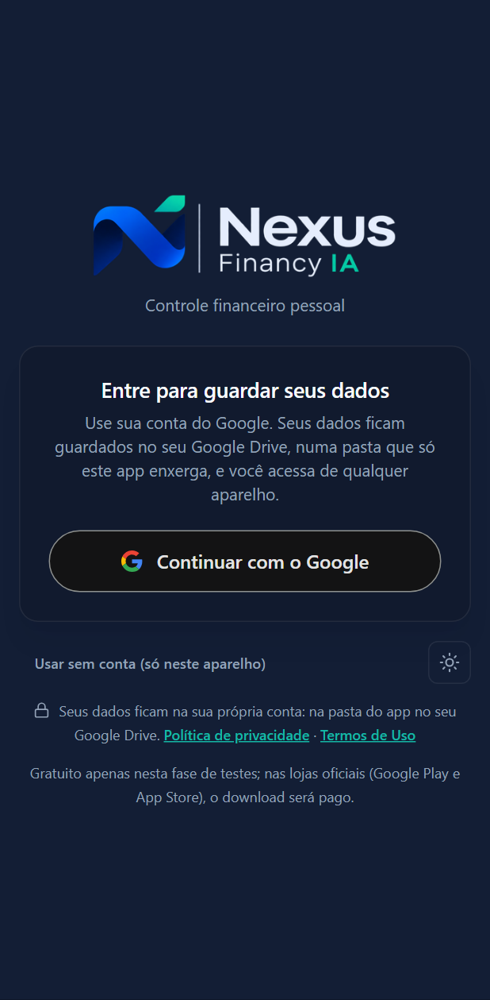<br><sub><b>Auditoria & Ritmo Mensal</b> e a <b>tela de entrada</b></sub></p>

> As capturas são do app com **dados de exemplo** (o botão "Ver com dados de exemplo" na tela de entrada). Para refazê-las: `npm run docs:screenshots`.

---

## 🚀 Como usar

### No navegador (computador ou celular)

1. Abra **https://gabrielmacsantos.github.io/sistema_gestao/**.
2. Toque em **Continuar com o Google** para guardar seus dados na sua conta, ou em **Usar sem conta** para só experimentar. Dá para ver tudo com **Ver com dados de exemplo**.
3. Siga o **tutorial** que abre sozinho no primeiro acesso.

> ⚠️ **Se o link chegou por WhatsApp, Instagram, Telegram ou e-mail**, abra-o no **Chrome** ou no **Safari** (toque em "Abrir no navegador"). O Google não deixa entrar com a conta dentro do navegador interno desses apps.

No celular, use **"Adicionar à tela inicial"** no menu do navegador para abrir como um app.

### No Android (app)

1. Baixe o **[APK](https://github.com/gabrielmacsantos/sistema_gestao/releases/download/app-latest/minhas-financas.apk)** e abra o arquivo. Como ele não vem da Play Store, o Android pede para **permitir instalar apps desta fonte** e pode mostrar um alerta do Play Protect: toque em *Instalar mesmo assim*.
2. Abra o **Nexus Financy IA** e entre com o Google.
3. **Atualizações:** ao abrir o app, ele avisa quando há versão nova ("Nova versão do app disponível"), com a lista do que mudou. Toque em **Atualizar** e instale por cima, sem perder nada.

### No dia a dia

- **Lançar rápido:** o botão **+** (ou **Novo gasto**) abre o formulário. O valor funciona como numa maquininha: digitar `4590` mostra `45,90`.
- **Falando ou escrevendo:** o balão de atalhos ✨ abre o **chat de lançamentos** e a **calculadora**.
- **Conferir o mês:** em **Auditoria & Ritmo Mensal**, filtre por Pago, Pendente ou Em análise e toque num dia da semana.
- **Trocar de mês:** use as setas ao lado do nome do mês para voltar ou avançar, ou toque no nome para escolher outro.

---

## 🔐 Seus dados e a privacidade

- **Não existe servidor nosso.** O app não recebe, não vê e não guarda os seus dados.
- **Sem conta:** os dados ficam só no navegador (ou no app) deste aparelho.
- **Com o Google:** os dados vão para a **pasta escondida do app no seu Google Drive**, que só este app enxerga e que não aparece entre os seus arquivos. É assim que você acessa de qualquer aparelho. O app só pede o acesso básico da conta (nome, e-mail e foto) e a pasta do app.
- **Voz:** o reconhecimento de fala é do navegador (Google no Chrome e no Android, Apple no Safari), que recebe o áudio. Isso é avisado antes do primeiro uso, e o lançamento só é salvo quando você toca em Salvar.
- **Sem anúncios, sem rastreamento, sem análise de uso.** Nada é vendido nem compartilhado.
- **Você manda nos dados:** em **Perfil** você sai da conta, e pode **excluir a conta**, o que apaga também os arquivos do app no seu Drive.

📄 [Política de privacidade](https://gabrielmacsantos.github.io/sistema_gestao/privacidade.html) · [Termos de Uso](https://gabrielmacsantos.github.io/sistema_gestao/termos.html) *(rascunho, em revisão)*

---

## ❓ Perguntas frequentes

<details>
<summary><b>O dono do app consegue ver minhas finanças?</b></summary>

Não. Os dados vão direto do seu aparelho para o **seu** Google Drive. Não passam por servidor nenhum nosso.
</details>

<details>
<summary><b>Posso usar sem criar conta?</b></summary>

Pode, em **Usar sem conta**. Os dados ficam só naquele navegador ou app: limpar os dados do navegador apaga tudo, e eles não aparecem em outros aparelhos. Se depois você entrar com o Google, o app pergunta se quer levar o que já lançou para a conta. **Faça um backup** (Backup → Baixar backup) antes de trocar de aparelho ou quando o teste terminar.
</details>

<details>
<summary><b>Celular e computador ao mesmo tempo funciona?</b></summary>

Sim, com a mesma conta do Google. Ao abrir o app (ou voltar para ele), vale a versão salva por último. Se os dois aparelhos forem alterados ao mesmo tempo, o app mostra "Os dados mudaram em dois lugares" e deixa você escolher.
</details>

<details>
<summary><b>O login com o Google não funciona. E agora?</b></summary>

No site, abra o link no Chrome ou no Safari (não dentro do WhatsApp ou do Instagram). No app, a tela de entrada mostra o motivo da falha numa caixa vermelha: mande esse texto para **[gabrielmac.dossantos@gmail.com](mailto:gabrielmac.dossantos@gmail.com)**.
</details>

<details>
<summary><b>O que acontece quando a versão de teste acabar?</b></summary>

Depois de 31/01/2027, o link deixa de abrir o app e mostra uma mensagem de encerramento. Quem entrou com o Google continua com os dados guardados no Drive, prontos para a versão das lojas. Quem usou **sem conta** deve baixar o backup antes da data.
</details>

<details>
<summary><b>Para onde vai o áudio quando lanço falando?</b></summary>

Para o serviço de voz do próprio navegador, que devolve o texto. O app não grava o áudio nem o envia para outro lugar.
</details>

---

## 🔧 Para quem mantém o projeto

### Como o app é feito

O app é o arquivo [`index.html`](./index.html): **um único arquivo HTML/JS, sem build e sem servidor**, publicado no **GitHub Pages** a partir da raiz da `main`. Qualquer push na `main` atualiza o site em cerca de um minuto.

O **app Android** é o mesmo `index.html` empacotado com o [Capacitor](https://capacitorjs.com/) (pasta [`mobile/`](./mobile)). A cada mudança no `index.html` ou em `mobile/`, o GitHub Actions monta o APK e o pacote da Play Store e os publica no pré-release [`app-latest`](https://github.com/gabrielmacsantos/sistema_gestao/releases/tag/app-latest). **Em todo commit que muda algo que a pessoa vê no app, inclua linhas `App: <texto em pt-BR>` na mensagem**: elas viram a lista "o que mudou" do aviso de atualização.

| Peça | Como funciona |
|---|---|
| **Contas** | Login com o Google (Google Identity Services no site e plugin nativo no app). Dados em `appDataFolder` do Drive da pessoa, como um arquivo JSON. |
| **Sincronização** | Salva depois de cada alteração; ao abrir ou voltar, vale o `savedAt` mais recente, com conflito assistido quando os dois lados mudam. |
| **Dinheiro** | Sempre **inteiros em centavos**, sem ponto flutuante; a formatação em BRL é só na tela. Backups e dados da nuvem são recusados se algum valor não for centavo inteiro. |
| **Datas** | Meses como `"YYYY-MM"` e agrupamentos no fuso `America/Sao_Paulo`. |
| **Prazo do teste** | `BETA_ENABLED`/`BETA_END_DATE` no bloco `// <beta-window>`. **Para as lojas, ponha `BETA_ENABLED = false`.** |
| **Recursos desligados** | Importar e leitura de notificações do banco, em `// <feature-flags>` (`ENABLE_IMPORT_FEATURE`, `ENABLE_BANK_NOTIFICATIONS`). |

Também existe, no repositório, uma **versão completa em Next.js 16 + Prisma/SQLite** (login por e-mail e código, NFC-e, foto de cupom com IA), guardada para quando houver servidor, e o [`android/`](./android), um leitor de notificações separado.

Todas as decisões, regras e padrões estão no **[CLAUDE.md](./CLAUDE.md)**.

### Testes

```bash
npm test                          # Vitest: unidade e integração
npx playwright install chromium webkit   # uma vez
npm run test:e2e                  # Playwright no site, em 4 ambientes
npm run test:e2e:report           # abre o relatório (print, trace e vídeo de quem falhou)
npm run test:evidence             # tudo + evidências em test-evidence/ (só no seu computador)
npm run docs:screenshots          # refaz as imagens deste README
```

A suíte E2E roda o site em **Chrome desktop (1440×900)**, **Safari/WebKit desktop (1280×800)**, **Pixel 7 (412×915)** e **iPhone 14 (390×844)**, sempre com navegador limpo, e falha qualquer teste que registre erro de console. Ela cobre navegação, filtros, centavos exatos, persistência offline, tema, voz, chat, tutorial, prazo da versão de teste, login nativo simulado e duas abas abertas.

### Versão completa (Next.js), para rodar no seu computador

```bash
git clone https://github.com/gabrielmacsantos/sistema_gestao.git
cd sistema_gestao
npm install
cp .env.example .env          # preencha o SESSION_SECRET (32+ caracteres)
npx prisma migrate deploy     # cria o banco em prisma/dev.db
npm run dev                   # http://localhost:3000
```

Variáveis em `.env`: `DATABASE_URL`, `SESSION_SECRET` (obrigatórias); `ANTHROPIC_API_KEY` e `ANTHROPIC_MODEL` (leitura de foto de cupom); `GOOGLE_CLIENT_ID` e `GOOGLE_CLIENT_SECRET` (login com Google); `COOKIE_SECURE` e `APP_URL`. Requer Node.js 20.19+. Não precisa de Docker nem de banco em nuvem.

### Design

A interface segue o design system **Sovereign Financial** ([`Design-google/`](./Design-google/sovereign_financial/DESIGN.md)): minimalismo de fintech, verde-azulado nas ações, tipografia Plus Jakarta Sans e Inter com algarismos tabulares nos valores, cards de cantos arredondados, menu lateral recolhível no desktop e barra inferior no celular. Todas as cores são tokens CSS, então os temas escuro e claro trocam a paleta inteira.

---

<div align="center">

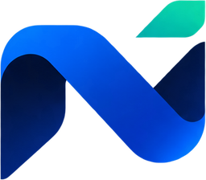<br>

Feito com ☕ por [Gabriel Santos](https://github.com/gabrielmacsantos) · Dúvidas, bugs e ajustes: [gabrielmac.dossantos@gmail.com](mailto:gabrielmac.dossantos@gmail.com)

</div>
