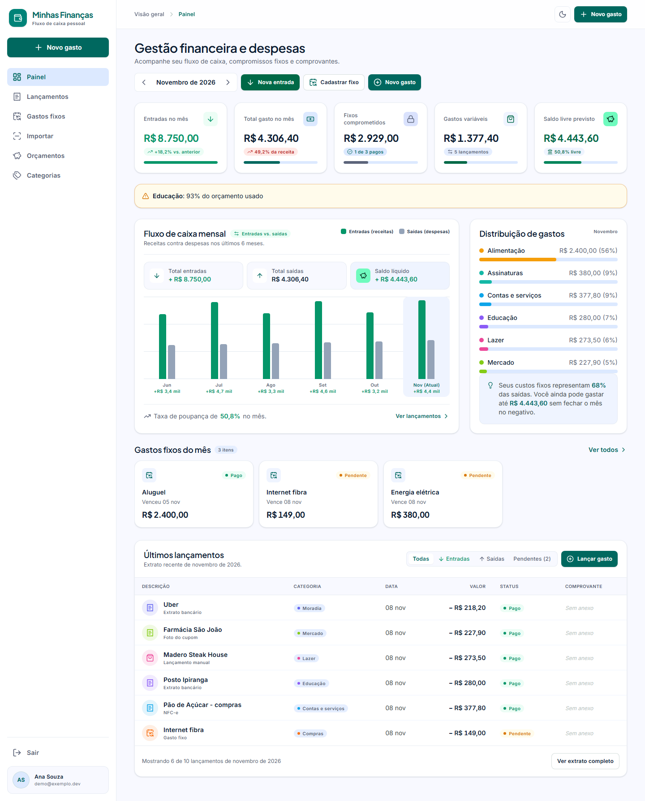
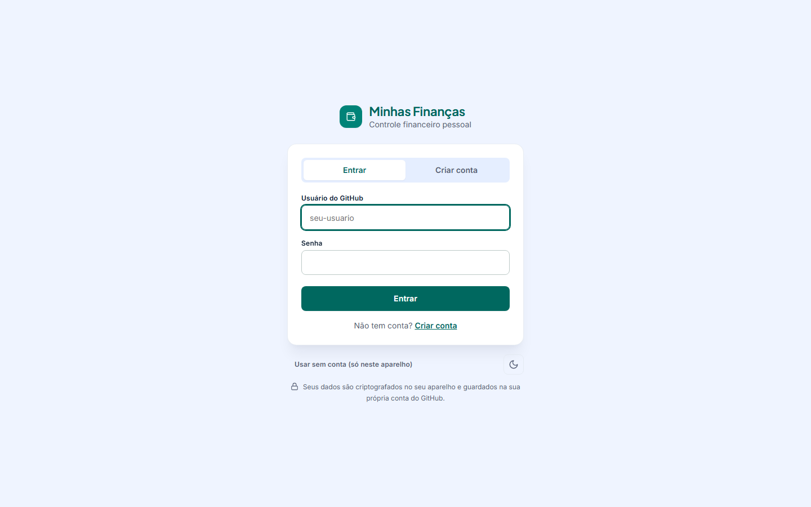
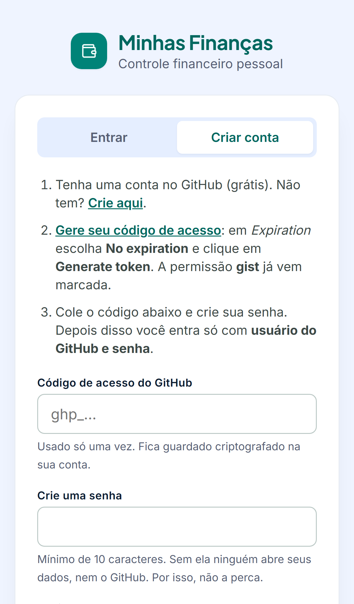
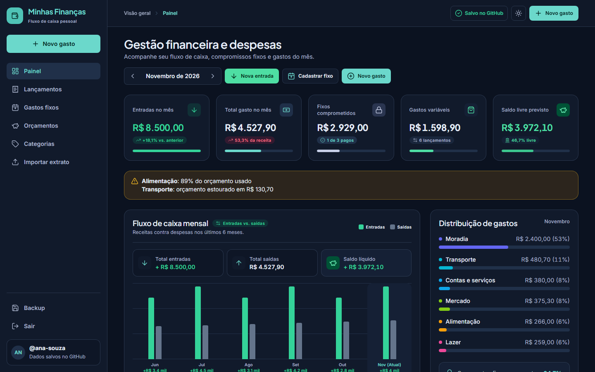
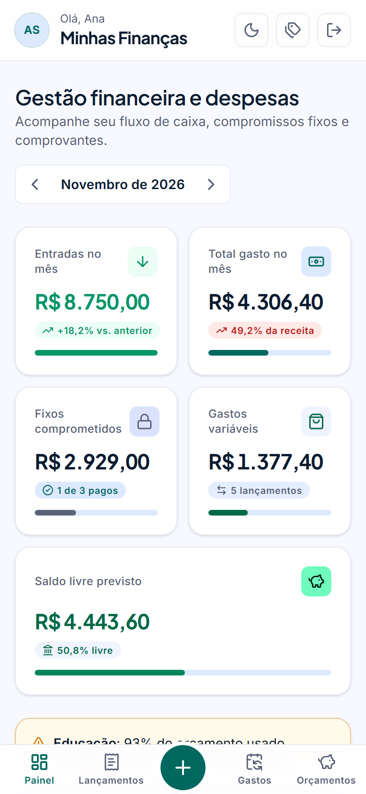
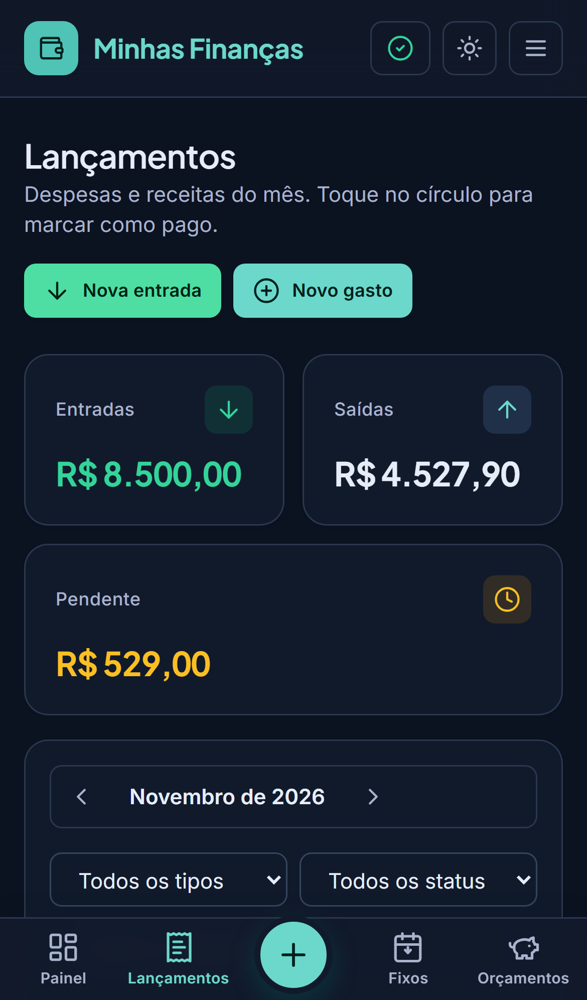
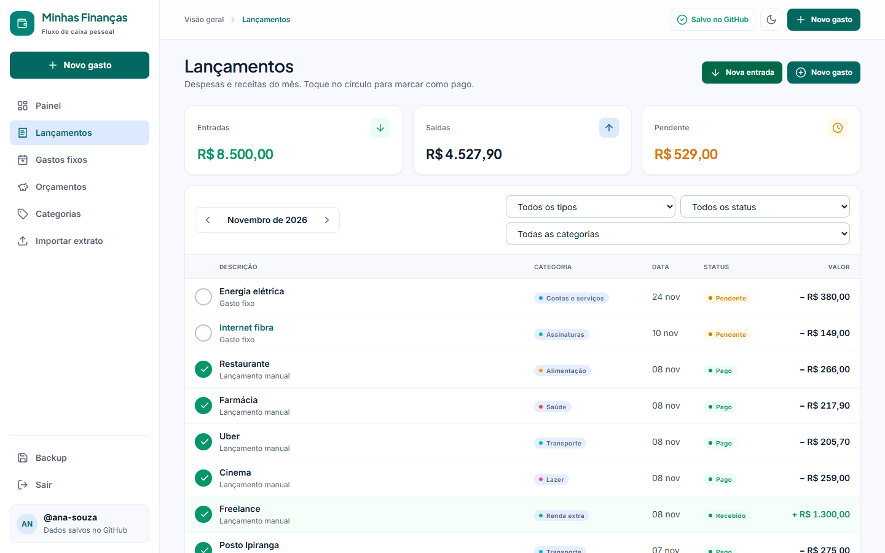

<div align="center">

# 💰 Minhas Finanças

**Controle financeiro pessoal para você e quem você quiser: gastos fixos, lançamentos, extratos, orçamentos e metas, num só lugar.**

### 👉 [Abrir o Minhas Finanças](https://gabrielmacsantos.github.io/sistema_gestao/)

**Cada pessoa cria a sua conta, entra com usuário e senha e vê só as próprias finanças.**<br/>
Funciona no celular e no computador, sem instalar nada e sem servidor: tudo roda dentro do GitHub.


<br/>



</div>

---

**Sumário:** [Como funciona](#-como-funciona-com-várias-pessoas) · [Passo a passo](#-passo-a-passo-para-quem-vai-usar) · [Perguntas frequentes](#-perguntas-frequentes) · [Recursos](#-o-que-dá-para-fazer) · [Telas](#-telas) · [Para quem mantém](#️-para-quem-mantém-o-projeto)

---

## 👥 Como funciona com várias pessoas

Todo mundo usa **o mesmo link**. Cada pessoa tem **login e cadastro próprios**, e os dados de cada uma ficam guardados **na conta do GitHub dela**:

```
            https://gabrielmacsantos.github.io/sistema_gestao/   (o mesmo site para todos)
                    │                     │                     │
              Entrar: ana            Entrar: bruno          Entrar: carla
              + senha da Ana         + senha do Bruno       + senha da Carla
                    │                     │                     │
         🔒 GitHub da Ana        🔒 GitHub do Bruno       🔒 GitHub da Carla
         (dados criptografados)  (dados criptografados)   (dados criptografados)
```

- 🔑 **Login:** o **usuário do GitHub** da pessoa + uma **senha** que ela cria no cadastro.
- 🗄️ **Onde ficam os dados:** num arquivo na conta do GitHub de cada pessoa, e não neste repositório nem num servidor.
- 🔒 **Privacidade:** tudo é **criptografado no próprio aparelho** (AES-256) antes de ir para o GitHub. Sem a senha da pessoa, ninguém lê, nem você, nem o GitHub.
- 📱 **Qualquer aparelho:** é só entrar com usuário e senha no celular ou no computador.
- 🆓 **Grátis:** só precisa de uma conta gratuita do GitHub.

Para convidar alguém, **basta mandar o link**. A pessoa não precisa de acesso a este repositório.

---

## 🚀 Passo a passo para quem vai usar

### 1. Criar conta (uma vez, uns 2 minutos)

1. **Tenha uma conta no GitHub.** Se não tiver, crie grátis em [github.com/signup](https://github.com/signup).
2. Abra **https://gabrielmacsantos.github.io/sistema_gestao/** e clique em **Criar conta**.
3. Clique em **"Gere seu código de acesso"**. O GitHub abre com a permissão certa (**gist**) já marcada.
4. Em *Expiration*, escolha **No expiration**, desça até o fim e clique em **Generate token**.
5. Copie o código (começa com `ghp_`), cole no campo **Código de acesso do GitHub** e **crie sua senha** (mínimo de 10 caracteres).
6. Clique em **Criar conta**. Pronto, você já está dentro.

> O código de acesso é usado **só no cadastro**: ele fica guardado, criptografado, dentro da sua conta. Daqui para frente você entra só com **usuário e senha**.

### 2. Entrar (em qualquer aparelho)

Abra o link, preencha **Usuário do GitHub** e **Senha** e clique em **Entrar**. Seus dados aparecem na hora. No mesmo aparelho, o site lembra de você até você clicar em **Sair**.

### 3. No dia a dia

- Lance gastos, marque contas como pagas e acompanhe o painel. Tudo é salvo sozinho: o topo mostra **"Salvo no GitHub ✓"**.
- **Viagens:** em **✈ Viagens** (no menu lateral ou, no celular, em ☰), crie a viagem e use **Novo gasto da viagem**. O painel avisa quanto ficou separado em viagens no mês. Para que os gastos de uma viagem entrem nos totais do mês, ligue **"Somar os gastos desta viagem à gestão do mês"** na página dela.
- **Lançar falando:** em **Novo gasto**, toque em **🎤 Falar o lançamento** e diga, por exemplo, *"gastei 52,30 no mercado ontem"* ou *"recebi o salário de 3.500 reais dia 5"*. Descrição, valor, data, categoria e tipo são preenchidos; você confere e toca em **Salvar**. Funciona no Chrome, Edge e Safari (no Firefox o botão não aparece).
- **Notificações do banco:** em **Importar**, cole o texto de notificações como *"Você recebeu um Pix de R$ 150,00 de Fulano"* ou *"Compra aprovada de R$ 52,30 em MERCADO X"*. Entradas e gastos aparecem para você conferir e confirmar. No Android dá para receber sozinho: veja [Receber as notificações do banco](#-receber-as-notificações-do-banco).
- **Comprovante:** no lançamento, toque em **Anexar comprovante** e tire a foto (ou escolha da galeria). O lançamento ganha um 📎 na lista e a foto abre com um toque. Valor e descrição você digita.
- No celular, use **"Adicionar à tela inicial"** no menu do navegador para abrir como um app.

### 4. Sair (importante em computador compartilhado)

Clique em **Sair** (no menu lateral ou, no celular, em **☰**). O site salva tudo e volta para a tela de login, sem deixar nada seu no navegador.

### Quer só conhecer antes?

Na tela de login, clique em **"Usar sem conta (só neste aparelho)"** e depois em **"Ver com dados de exemplo"**. Sem conta, os dados ficam só naquele navegador. Se depois você criar uma conta, o que já lançou vai junto.

---

## 🔔 Receber as notificações do banco

Um site não consegue ler as notificações de outros apps: o celular não deixa. Então um app de automação faz a ponte e entrega o texto ao site. As notificações caem numa fila (**"3 notificações do banco para revisar"** no Painel) e **só viram lançamento quando você confirma**. Avisos de saldo, de fatura a vencer e códigos são ignorados.

Antes de começar, abra o site no celular, entre na sua conta e copie o seu endereço em **Importar → Receber sozinho no Android → Copiar**. Ele termina em `#/notificacao?t=`.

### Android, com o MacroDroid (grátis)

1. Instale o **MacroDroid** pela Play Store, abra e, quando ele pedir, permita o **acesso às notificações**.
2. Toque em **Adicionar macro**.
3. **Gatilho:** *Notificação → Notificação recebida*. Marque os apps dos seus bancos (Nubank, Itaú, Inter, Bradesco, Caixa, Banco do Brasil, C6, Santander, PicPay, Mercado Pago…) e, se você paga por aproximação com o celular, também a **Carteira do Google (Google Wallet)** ou a **Samsung Wallet**. Em texto, deixe *qualquer*.
4. **Ação:** *Aplicações → Abrir site/URL*. Cole o endereço copiado e, logo depois dele, use o botão de **texto mágico** (`…`) para inserir o **título** e o **texto da notificação**.
5. Dê um nome (ex.: "Minhas Finanças") e salve.

A cada notificação de banco, o navegador abre o site com a notificação pronta para conferir. Quando a carteira e o banco do cartão avisam a mesma compra, a segunda vem desmarcada como **"possível duplicado"**: a compra entra uma vez só. Os nomes das opções podem variar um pouco conforme a versão do MacroDroid.

**Prefere não abrir o navegador a cada notificação?** Troque a ação do passo 4 por *Variáveis → Definir variável*: acrescente ao fim de uma variável de texto (ex.: `fila`) uma linha `---`, a data no formato dia/mês/ano e o texto da notificação. Depois crie um segundo macro com o gatilho *Atalho na tela inicial*. Ele deve abrir o endereço seguido da variável `fila` e, em seguida, limpar a variável. Assim, um toque no atalho manda tudo de uma vez, cada notificação com a data em que chegou.

### iPhone

O iPhone não deixa nenhum app ler notificações de outros apps. O que dá para fazer:

- **Pix e o resto:** copie o texto da notificação (muitos bancos mostram as notificações dentro do próprio app) e cole em **Importar → Notificações do banco**. Dá para colar várias de uma vez, separadas por uma linha em branco.
- **Compras com Apple Pay:** no app **Atalhos**, crie uma *Automação → Carteira (Transação)*, escolha seus cartões e *Executar imediatamente*. A ação deve ser **Abrir URLs**, com o seu endereço seguido de `Compra aprovada de ` + *Quantia* + ` em ` + *Comerciante*.

### Privacidade

O texto vai no fim do endereço, depois do `#`. Essa parte não é enviada ao GitHub: fica só no navegador, que a apaga do endereço assim que lê. O MacroDroid e o Atalhos rodam no próprio celular.

---

## ❓ Perguntas frequentes

<details>
<summary><b>Esqueci a senha. E agora?</b></summary>

A senha não fica guardada em lugar nenhum, e é isso que garante a privacidade. Sem ela, **os dados não podem ser abertos**. Se o site ainda estiver aberto em algum aparelho seu, vá em **Backup → Baixar backup** para salvar uma cópia. Depois apague o arquivo *"Minhas Finanças: dados criptografados"* em [gist.github.com](https://gist.github.com), crie a conta de novo e use **Backup → Restaurar** com a cópia.
</details>

<details>
<summary><b>Qual é o meu "usuário do GitHub"?</b></summary>

É o nome que aparece no endereço do seu perfil: em `github.com/ana-silva`, o usuário é `ana-silva`. Não é o e-mail.
</details>

<details>
<summary><b>O dono do site ou do repositório consegue ver minhas finanças?</b></summary>

Não. Os dados não passam por nenhum servidor nem por este repositório: vão direto do seu aparelho para a **sua** conta do GitHub, já criptografados com a **sua** senha.
</details>

<details>
<summary><b>Vi um arquivo "Minhas Finanças" no meu perfil do GitHub. É seguro?</b></summary>

É ali que seus dados ficam. O arquivo é público para que você consiga entrar só com usuário e senha em qualquer aparelho, mas o conteúdo é **ilegível sem a sua senha**. Por isso o cadastro exige no mínimo 10 caracteres: prefira uma frase longa. **Não apague nem edite esse arquivo**, ou você perde os dados.
</details>

<details>
<summary><b>Celular e computador ao mesmo tempo funciona?</b></summary>

Sim. Ao abrir o site (ou voltar para a aba), ele busca a versão mais recente. Se você alterar nos dois aparelhos ao mesmo tempo, vale a versão salva por último.
</details>

<details>
<summary><b>Onde ficam as fotos dos comprovantes?</b></summary>

No seu aparelho e, com conta, num segundo arquivo do seu GitHub (*"Minhas Finanças: comprovantes criptografados"*), também ilegível sem a sua senha. Em outro aparelho, cada foto é baixada só quando você abre o lançamento. O **Baixar backup** em arquivo não inclui as fotos.
</details>

<details>
<summary><b>Para onde vai o áudio quando lanço falando?</b></summary>

Para o serviço de voz do próprio navegador (Google no Chrome e no Android, Apple no Safari), que devolve o texto. O site não grava o áudio nem o envia para outro lugar, e o lançamento só é salvo quando você toca em **Salvar**. O aviso aparece na primeira vez que você usa.
</details>

<details>
<summary><b>Posso usar sem conta?</b></summary>

Pode, pelo botão **"Usar sem conta"** na tela de login. Os dados ficam só naquele navegador: limpar os dados de navegação apaga tudo, e eles não aparecem em outros aparelhos.
</details>

---

## ✨ O que dá para fazer

| | |
|---|---|
| 📊 **Painel completo** | Entradas, total gasto, fixos comprometidos, gastos variáveis e saldo livre previsto, com fluxo de caixa de 6 meses e distribuição por categoria. |
| 🔁 **Gastos fixos automáticos** | Aluguel, contas e assinaturas geram um lançamento pendente por mês, sozinhos. Editar um fixo nunca altera o passado. |
| ✈️ **Viagens** | Uma aba só para viagens: crie a viagem (datas e orçamento) e lance nela passagens, hotel e passeios. Esses gastos ficam **separados** da gestão do mês, e uma chave em cada viagem decide se eles devem ser **somados** ou não. |
| 🔔 **Notificações do banco** | Pix recebido, compra aprovada, depósito: cole a notificação ou, no Android, receba sozinho com o MacroDroid. Tudo cai numa fila para você confirmar, com aviso de possível duplicado. |
| 🎤 **Lançar falando** | Toque no microfone e fale o gasto: o formulário é preenchido (valor, data, categoria, tipo) para você conferir e salvar. |
| 📷 **Foto do comprovante** | Tire uma foto pelo celular (ou escolha da galeria) e anexe ao lançamento. Ela é reduzida no aparelho e salva criptografada no seu GitHub. |
| 🏦 **Extrato OFX/CSV** | Importe o extrato do banco, revise antes de salvar e sem duplicar o que já foi importado. |
| 🎯 **Orçamentos e metas** | Limite mensal por categoria, com alerta a partir de 80%, e metas de economia. |
| 🔐 **Login e cadastro** | Cada pessoa com usuário, senha e dados próprios, criptografados na conta do GitHub dela. |
| 🌗 **Tema claro e escuro** | Segue o sistema ou a sua escolha. |
| 🧾 **NFC-e e leitura automática da foto** | Leitura do QR Code do cupom fiscal e dos valores da foto com IA. *Só na versão completa, que roda num computador (veja abaixo).* |

---

## 📱 Telas

<table>
  <tr>
    <td width="68%"></td>
    <td width="32%" colspan="2"></td>
  </tr>
  <tr>
    <td align="center"><sub>Login: usuário do GitHub + senha</sub></td>
    <td align="center" colspan="2"><sub>Cadastro no celular</sub></td>
  </tr>
  <tr>
    <td width="68%"></td>
    <td width="16%"></td>
    <td width="16%"></td>
  </tr>
  <tr>
    <td align="center"><sub>Painel · tema escuro</sub></td>
    <td align="center"><sub>Celular</sub></td>
    <td align="center"><sub>Celular · escuro</sub></td>
  </tr>
</table>


<p align="center"><sub>Lançamentos com filtros por mês, tipo, status e categoria. Um toque marca como pago.</sub></p>

> As capturas são do site online, com uma conta e dados fictícios.

---

## 🛠️ Para quem mantém o projeto

### Como o site online é publicado

O site é o arquivo [`index.html`](./index.html): um único arquivo HTML/JS, sem build e sem servidor, publicado pelo **GitHub Pages** a partir da raiz da branch `main`. **Qualquer push na `main` atualiza o site** em cerca de 1 minuto.

- **Contas sem servidor:** no cadastro, a pessoa informa um token do GitHub (escopo `gist`) e cria uma senha. O site grava na conta dela um Gist com um único arquivo, `minhas-financas.json`, que guarda os dados **e o token**, criptografados com AES-256-GCM. A chave é derivada da senha com PBKDF2-SHA256 (310 mil iterações) e nunca sai do aparelho.
- **Login com usuário + senha:** o site lista os gists públicos do usuário (API pública do GitHub), baixa o arquivo, decifra com a senha e recupera o token de dentro dele para continuar salvando. Por isso o Gist é **público**: só o texto cifrado fica exposto, e a senha mínima é de 10 caracteres.
- **Fotos de comprovante:** reduzidas no aparelho (até 1600px, JPEG), guardadas no IndexedDB e, com conta, cifradas com a mesma chave e enviadas como um arquivo por foto num segundo Gist (`comprovantes`), para o arquivo principal continuar pequeno. Outros aparelhos baixam pela URL *raw* do Gist só quando a foto é aberta.
- **Notificações do banco:** `parseBankNotification` e `splitNotifications` (bloco `// <notification-parser>` no `index.html`, testado em `tests/notification-parser.test.ts`) leem o texto pelo vocabulário comum dos bancos (Pix recebido/enviado, compra aprovada, depósito, saque, boleto, estorno), sem um layout por banco. O que chega por `#/notificacao?t=<texto>` vai para `state.inbox` depois de buscar a versão mais recente do Gist, e tudo passa pela tela de revisão. Os lançamentos ganham `source: "NOTIFICATION"` e `externalId` `notif:<hash do texto|data>`.
- **Lançamento por voz:** usa a Web Speech API do navegador (`SpeechRecognition`, `pt-BR`), que manda o áudio ao serviço de voz do Google ou da Apple. Isso é avisado antes do primeiro uso. O texto passa por `parseSpokenTransaction` (bloco `// <voice-parser>` no `index.html`, testado em `tests/voice-parser.test.ts`), que só preenche o formulário.
- **Por que não neste repositório:** ele é público e compartilhado. Cada pessoa grava só na própria conta.
- **Por que não um botão "Entrar com GitHub":** o OAuth do GitHub exige um servidor para guardar o *client secret*, e o GitHub Pages não executa código no servidor.
- **Requisito para publicar:** em *Settings → Pages*, deixe *Source: Deploy from a branch*, *Branch: `main` / `(root)`*.

### Versão completa (rodando no seu computador)

Tem login próprio com e-mail e senha, banco SQLite, leitura de NFC-e e foto de cupom com IA. Os dados ficam no computador onde ela roda.

**Requisito:** Node.js 20.19+ (testado com Node 24). Não precisa de Docker nem de banco em nuvem.

```bash
git clone https://github.com/gabrielmacsantos/sistema_gestao.git
cd sistema_gestao
npm install
cp .env.example .env          # preencha o SESSION_SECRET (veja abaixo)
npx prisma migrate deploy     # cria o banco em prisma/dev.db
npm run dev
```

Abra **http://localhost:3000** e crie sua conta. Cada conta nova já recebe um conjunto de categorias padrão.

#### ⚙️ Variáveis de ambiente

| Variável | Obrigatória | Descrição |
|---|:---:|---|
| `DATABASE_URL` | ✅ | Caminho do SQLite. Padrão: `file:./prisma/dev.db` |
| `SESSION_SECRET` | ✅ | 32+ caracteres. Gere com `node -e "console.log(require('crypto').randomBytes(32).toString('hex'))"` |
| `ANTHROPIC_API_KEY` | | Ativa a leitura de fotos de cupom. Sem ela, a aba de foto mostra como configurar |
| `ANTHROPIC_MODEL` | | Modelo de visão. Padrão: `claude-opus-5-5` |
| `COOKIE_SECURE` | | `true` apenas se o app for servido em HTTPS |

#### 📲 Usando no celular

Com o computador e o celular na mesma rede, acesse `http://<IP-do-computador>:3000`.

A câmera ao vivo para QR Code exige HTTPS (ou localhost). Pelo IP, use o botão **"Foto do QR Code"**, que abre a câmera do celular do mesmo jeito.

#### ⚡ Produção local

```bash
npm run build
npm start
```

O build de produção é bem mais rápido que o modo de desenvolvimento.


---

## 🧱 Stack

| Camada | Tecnologia |
|---|---|
| Framework | Next.js 16 (App Router, Turbopack, Server Actions) + React 19 |
| Linguagem | TypeScript estrito, validação com Zod 4 compartilhada entre cliente e servidor |
| UI | Tailwind CSS 4 + design system próprio *Sovereign Financial* + ícones Lucide |
| Banco | SQLite via Prisma 7 (`better-sqlite3`), em modo WAL |
| Autenticação | Sessão em cookie criptografado (iron-session) + senhas com bcrypt |
| Gráficos | HTML/CSS renderizado no servidor, sem JavaScript no navegador |
| Importação | `jsqr` (QR Code), `cheerio` (SEFAZ), parser OFX próprio, `papaparse` (CSV) |
| IA | Claude API (`@anthropic-ai/sdk`), com saída estruturada e validada |
| Testes | Vitest (unidade + integração) e Playwright (E2E desktop e mobile) |

---

## 🗂️ Arquitetura

```
src/
├── app/
│   ├── (auth)/          # login e cadastro
│   ├── (app)/           # área logada: painel, lançamentos, fixos, importar, orçamentos, categorias
│   └── api/anexos/      # serve comprovantes apenas para o dono
├── components/          # UI compartilhada (cards, badges, tabela de lançamentos, formulários)
├── server/
│   ├── auth.ts          # Data Access Layer: o userId vem sempre da sessão
│   ├── services/        # regras de negócio
│   ├── repositories/    # acesso ao Prisma, sempre filtrado por userId
│   └── integrations/    # NFC-e, foto com IA, extratos OFX/CSV
└── lib/                 # funções puras: dinheiro, datas, recorrência, fluxo de caixa, validação
```

**Fluxo de uma mutação:** `página → server action → service → repository → Prisma`

**Pipeline de importação:** `fonte → parser → rascunho → detecção de duplicados → tela de revisão → confirmação → salvar`

### Princípios

- 💵 **Dinheiro em centavos inteiros**, sem ponto flutuante. A formatação em BRL acontece só na tela.
- 🕐 **Datas em UTC**, com meses e agrupamentos no fuso `America/Sao_Paulo`.
- 🔒 **Isolamento por usuário em toda leitura e escrita**, coberto por testes de integração.
- 🛡️ **Privacidade:** nada de analytics ou bancos em nuvem. Na versão completa, só saem da máquina as fotos de cupom (para a Claude API) e a URL do QR Code (para a SEFAZ). No site online, os dados só saem criptografados, para o Gist da própria pessoa.

Detalhes, padrões de código e regras do projeto: veja o [CLAUDE.md](./CLAUDE.md).

---

## 🎨 Design system

A interface segue o **Sovereign Financial** ([`Design-google/sovereign_financial/DESIGN.md`](./Design-google/sovereign_financial/DESIGN.md)), um minimalismo preciso com toques de fintech:

- **Cores:** verde-azulado profundo nas ações, verde-esmeralda para fluxo positivo e rosa para déficits e alertas.
- **Tipografia:** Plus Jakarta Sans nos títulos e números de destaque e Inter no corpo, com algarismos tabulares nos valores.
- **Superfícies:** painéis brancos com bordas finas, cabeçalho translúcido e cantos de 16px nos cards.
- **Layout:** menu lateral de 260px no desktop, dock de ícones no tablet e barra inferior com botão de ação no celular.

Todas as cores são tokens CSS, então os temas claro e escuro trocam a paleta inteira sem duplicar estilos.

---

## 🧪 Testes e qualidade

```bash
npm run typecheck                 # TypeScript
npm run lint                      # ESLint
npm test                          # unidade + integração (usa prisma/test.db)
npx playwright install chromium   # uma vez
npm run test:e2e                  # E2E desktop e mobile (usa prisma/e2e.db)
```

Os testes cobrem os parsers de NFC-e, OFX, CSV e da resposta da IA, os cálculos de dinheiro, datas, recorrência e fluxo de caixa, e o isolamento entre usuários. Os bancos de teste são separados do seu banco real.

### Comandos úteis

| Comando | O que faz |
|---|---|
| `npm run db:migrate -- --name <descricao>` | Cria e aplica uma migration |
| `npm run db:generate` | Regenera o Prisma Client |
| `npm run db:studio` | Abre o Prisma Studio para inspecionar o banco |

---

<div align="center">

Feito com ☕ e TypeScript por [Gabriel Santos](https://github.com/gabrielmacsantos)

</div>
